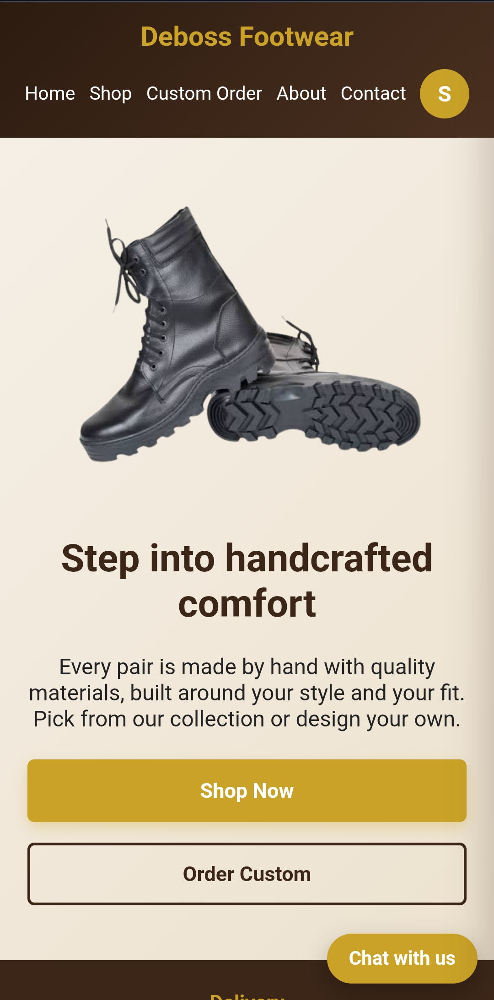

# Deboss Footwear

A Django-powered e-commerce platform for footwear and fashion accessories, including shoes, belts, and more.

The Delivery allows customers to browse products, explore categories, view product details, manage their shopping carts, and place orders online using Pay on Delivery..

## Homepage Preview



### Custom Order Enquiries


## Technology Stack:
- **Backend:** Python, Django
- **Database:** PostgreSQL
- **Frontend:** HTML, CSS, JavaScript, Bootstrap
- **Deployment:** Render
- **Database Hosting:** Neon

## Features

- Customer registration, login, and authentication
- Product browsing and category filtering
- Product details with size and variant selection
- Shopping cart management
- Inventory and stock management
- Checkout with Pay on Delivery
- Customer order history and order details
- Order status and payment status management
- **Custom order enquiries through WhatsApp**
- Direct WhatsApp communication for customer enquiries
- Admin dashboard for managing products, inventory, and orders

## Architecture
Deboss Footwear follows Django's Model-Template-View (MTV) architecture.
- **Models:** Handle application data, products, customers, inventory, carts, and orders.
- **Views:** Process requests, apply business logic, and coordinate application operations.
- **Templates:** Render the user interface using Django templates.
- **Database:** PostgreSQL stores the application's persistent data.

## Local Setup

1. Clone the repository:

   ```bash
   git clone https://github.com/corni-codes/shoe-store.git

## Deployment
The application is deployed on Render, with Neon PostgreSQL providing the production database.

## Project Status
**Status:** Live
The application is deployed and accessible online.

## Author
Developed by **corni-codes**.
